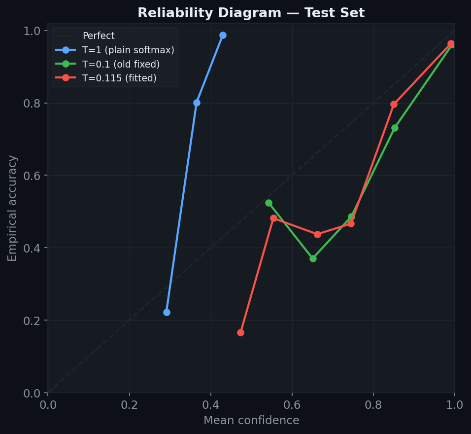
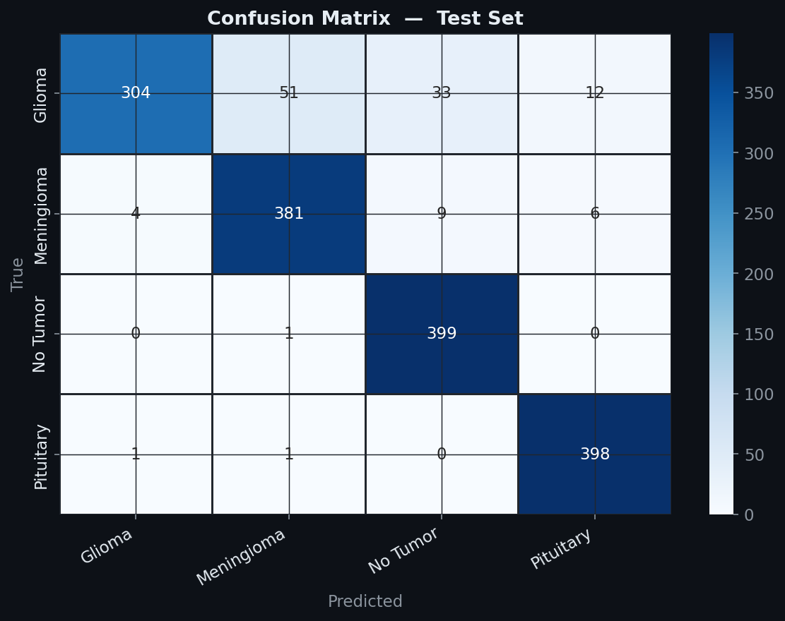
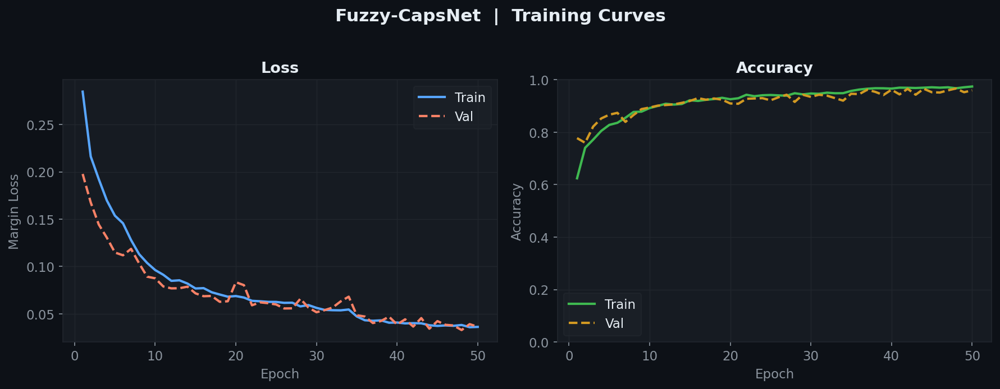

# Fuzzy-CapsNet — Brain Tumor Classification

<p align="center">
  
  
  
  
</p>

<p align="center">
  <a href="https://colab.research.google.com/github/nooragab/fuzzy-capsnet-brain-tumor-classification/blob/main/notebooks/fuzzy_capsnet.ipynb">
    
  </a>
</p>

A **Hybrid Fuzzy Capsule Network** for classifying brain MRI scans into 4 categories (glioma, meningioma, no tumor, pituitary). The core idea replaces classic CapsNet's dot-product routing with **Gaussian Fuzzy Membership routing**, where each output capsule has a learnable routing bandwidth.

> **Research / educational project — not a diagnostic tool.** See [Limitations](#limitations).

---

## Table of Contents

- [Overview](#overview)
- [Architecture](#architecture)
- [Inference API](#inference-api)
- [Probability Calibration](#probability-calibration)
- [Fuzzy Membership Scores](#fuzzy-membership-scores)
- [Dataset](#dataset)
- [Results](#results)
- [Limitations](#limitations)
- [Usage](#usage)
- [Live Demo](#live-demo)
- [How Fuzzy Routing Works](#how-fuzzy-routing-works)
- [Project Structure](#project-structure)
- [References](#references)

---

## Overview

Standard Capsule Networks use iterative dynamic routing based on dot-product agreement. This project replaces that mechanism with **Fuzzy Gaussian Membership routing**:

$$\mu(\hat{u}, v) = \exp\!\left(-\frac{\|\hat{u} - v\|^2}{2\sigma^2}\right)$$

where $\sigma$ is a **learnable parameter per output capsule**, so the network can adapt its routing sensitivity during training.

**Design properties:**
- Routing memberships are naturally bounded in `(0, 1]`
- Smooth, differentiable routing signal across iterations
- Per-class routing bandwidth (`σ_j`)

> This project does **not** include an ablation against standard dynamic routing, so it makes no claim that fuzzy routing performs better than classic CapsNet routing.

---

## Architecture

```
Input (3×64×64)
       │
       ▼
ConvFeatureExtractor          ← 3-block CNN (32→64→128 channels) + BatchNorm + Dropout
       │
       ▼
PrimaryCapsLayer              ← CNN features → 8-D capsule vectors (squash activation)
       │
       ▼
FuzzyCapsuleLayer             ← Gaussian Membership Routing (3 iterations, σ learnable)
       │
       ▼
L2-Norm                       ← Capsule norms ∈ (0,1) — used directly for MarginLoss
       │
       ▼
Prediction API                ← Temperature-scaled softmax / normalised activation shares
```

| Component | Details |
|-----------|---------|
| Input size | 64 × 64 × 3 |
| Primary capsules | 32 capsules × 8-D per spatial location |
| Output capsules | 4 capsules × 16-D (one per class) |
| Routing iterations | 3 |
| Total parameters | **1,437,444** |
| Loss function | CapsNet Margin Loss (Hinton et al., 2017) |
| Inference temperature | **T = 0.1146** (fitted on the validation set, see [Calibration](#probability-calibration)) |

---

## Inference API

`forward()` returns raw capsule norms only — a single tensor `(B, num_classes)`. Five inference helpers keep training and evaluation concerns separate:

| Method | Returns | Purpose |
|--------|---------|---------|
| `forward(x)` | norms `(B, C)` | Training — passed directly to MarginLoss |
| `predict_logits(x)` | norms `(B, C)` | Raw capsule activations for inspection |
| `predict_proba(x)` | probs `(B, C)` | Temperature-scaled softmax probabilities |
| `predict_membership(x)` | memberships `(B, C)` | Normalised capsule activation shares (sum to 1) |
| `predict_with_details(x)` | dict | All of the above in one call |

`predict_with_details()` returns:
```python
{
    "norms":         Tensor (B, C),   # raw capsule norms
    "probabilities": Tensor (B, C),   # temperature-scaled softmax
    "memberships":   Tensor (B, C),   # normalised activation shares
    "predictions":   Tensor (B,),     # argmax class indices
    "confidence":    Tensor (B,),     # max probability per sample
}
```

The temperature can be changed at any time without retraining (the argmax, and therefore accuracy, never changes):
```python
model.set_temperature(0.1146)   # value fitted in the notebook (Section 4b)
```

---

## Probability Calibration

Capsule norms are **not logits**. Margin Loss trains the correct class norm towards `0.9` and the others towards `0.1`, so norms live roughly in `[0.1, 0.9]`. A plain softmax on such a narrow range is very flat: with `T = 1` the top probability is at most ≈ 0.43, even when the model is always right.

The model therefore applies **temperature scaling** at inference only (training is untouched):

$$p_i = \frac{\exp(\text{norm}_i \;/\; T)}{\sum_j \exp(\text{norm}_j \;/\; T)}$$

`T` is **fitted on the validation set** by minimising NLL, then evaluated on the **held-out test set** (never used for fitting). Notebook Section 4b does this and writes `results/calibration.json`.

### Test-set calibration results

| Temperature | ECE ↓ | NLL ↓ | Brier ↓ |
|-------------|-------|-------|---------|
| `T = 1` (plain softmax) | 0.5163 | 0.9285 | 0.4851 |
| `T = 0.1` (earlier hand-picked value) | 0.0455 | 0.3594 | 0.1238 |
| **`T = 0.1146` (fitted on validation)** | **0.0386** | **0.3256** | **0.1219** |

ECE uses 15 bins on the top-label confidence. The acceptance criterion was set in advance in the notebook (test ECE ≤ 0.05 and better than the previous fixed `T`); the fitted temperature meets it.

<p align="center">
  
</p>

**How to read this honestly:** the aggregate ECE is low, but the reliability diagram shows the model is **overconfident in the mid-confidence range** (≈ 0.5–0.85; e.g. ≈ 0.66 confidence vs ≈ 0.44 accuracy). ECE stays small mainly because most test samples fall in the top-confidence bin (≈ 0.99 confidence vs ≈ 0.96 accuracy). Test ECE (0.039) is also higher than validation ECE (0.012), because the validation split is easier than the test set (96.7% vs 92.6% accuracy).

---

## Fuzzy Membership Scores

Membership scores express **how strongly each class capsule was activated**, as a fraction of the total capsule activity:

$$\mu_i = \frac{\text{norm}_i}{\sum_j \text{norm}_j}$$

Values are non-negative and sum to exactly 1, and they preserve the relative activation ratios between class capsules. Note that this is a **normalised output-activation share**, not the internal Gaussian routing memberships (those are computed per primary capsule inside `FuzzyCapsuleLayer` and can be exposed with `return_memberships=True`). It is also a different view from the softmax probabilities: probabilities are a sharpened decision output, memberships are a linear share of activation.

> The Gaussian kernel is never exactly zero for a finite distance, so every primary capsule always contributes *some* membership to *every* output capsule. Partial membership is the design intent of fuzzy routing.

---

## Dataset

Uses the **Brain Tumor MRI Dataset** ([Kaggle](https://www.kaggle.com/datasets/masoudnickparvar/brain-tumor-mri-dataset)), organised as:

```
dataset/
├── Training/
│   ├── glioma/        (1400 images)
│   ├── meningioma/    (1400 images)
│   ├── notumor/       (1400 images)
│   └── pituitary/     (1400 images)
└── Testing/
    ├── glioma/        (400 images)
    ├── meningioma/    (400 images)
    ├── notumor/       (400 images)
    └── pituitary/     (400 images)
```

| Split | Samples | Notes |
|-------|---------|-------|
| Train | 4,760 | with augmentation |
| Validation (15% of Training/) | 840 | **no augmentation**; used for early stopping and temperature fitting |
| Test (official `Testing/`) | 1,600 | never used for training or fitting |

The train/validation split uses `random_split` with seed 42 over two separate `ImageFolder` objects (one augmented, one clean) indexed with the **same indices**, so the split is a clean partition. Training augmentations: random horizontal flip, rotation (±15°), colour jitter.

---

## Results

All numbers below are on the official **test set** (1,600 images) unless stated otherwise.

| Metric | Score |
|--------|-------|
| **Accuracy** | **92.63%** |
| Precision (weighted) | 93.08% |
| Recall (weighted) | 92.63% |
| F1-Score (weighted) | 92.39% |
| F1-Score (macro) | 92.39% |
| ROC-AUC (macro OvR) | **98.73%** |

### Per-class breakdown

| Class | Precision | Recall | F1-Score |
|-------|-----------|--------|----------|
| Glioma | 0.9838 | **0.7600** | 0.8575 |
| Meningioma | 0.8779 | 0.9525 | 0.9137 |
| No Tumor | 0.9048 | 0.9975 | 0.9489 |
| Pituitary | 0.9567 | 0.9950 | 0.9755 |

<p align="center">
  
</p>

### Training / validation

| Split | Accuracy |
|-------|----------|
| Train (4,760 images, no augmentation at eval time) | 99.08% |
| Validation (840 images) | 96.67% |
| **Test (1,600 images)** | **92.63%** |

Training ran for **50 epochs** (the maximum; early stopping with patience 5 did not trigger) on a Colab **T4 GPU**, at about 20 s per epoch. The best checkpoint was selected on validation loss (`val_loss = 0.0329`, epoch 48).

<p align="center">
  
</p>

---

## Limitations

- **Glioma recall is 76%.** Of 400 test gliomas, 51 were predicted as meningioma, 33 as no tumor and 12 as pituitary. A "No Tumor" prediction from this model does **not** rule out a tumor.
- **Validation is easier than test** (96.7% vs 92.6%). The validation split comes from the same folder as the training data, so it likely shares near-duplicate or same-source slices. The test number is the one to trust.
- **Calibration is only partial.** Aggregate ECE is low (0.039), but the model is overconfident in the 0.5–0.85 confidence range. The single temperature was fitted on the easier validation set.
- **Low resolution:** images are resized to 64×64, which discards fine detail.
- **Single data source:** train and test come from the same public dataset. No external or cross-institution validation was done.
- **No ablation:** there is no comparison against standard dynamic routing or a plain CNN baseline.
- **Not a medical device.** Do not use for clinical decisions.

---

## Usage

### 1. Run on Google Colab (recommended)

Click the **Open In Colab** badge at the top, set **Runtime → Change runtime type → T4 GPU**, and run all cells. The notebook:
- mounts your Google Drive and saves outputs to `MyDrive/fuzzy_capsnet/`,
- downloads the dataset from Kaggle automatically (falls back to a `kaggle.json` upload if needed),
- trains, calibrates and evaluates the model.

### 2. Notebook sections

| Section | Description |
|---------|-------------|
| 0 | Colab setup (Drive, dataset download) |
| 1 | Imports & Configuration |
| 2 | Model Architecture — FuzzyCapsNet + inference API |
| 3 | Data Loading (augmented train / clean validation) |
| 4 | Training (50 epochs, Margin Loss, early stopping) |
| 4b | Calibration check — temperature scaling, ECE / NLL / Brier |
| 5 | Quick Evaluation — metrics & plots |
| 6 | Full Evaluation — 8 detailed plots |
| 7 | Single-Image Prediction & Explainability |
| 8 | View saved figures |

### 3. Single-image prediction

```python
model = FuzzyCapsNet(img_size=64)
model.load_state_dict(torch.load('models/fuzzy_capsnet.pt', map_location='cpu'))
model.set_temperature(0.1146)

details = model.predict_with_details(image_tensor)   # image_tensor: (1, 3, 64, 64), normalised
print(details["predictions"], details["confidence"])
```

### Configuration

```python
IMG_SIZE            = 64
BATCH_SIZE          = 16
NUM_EPOCHS          = 50
LEARNING_RATE       = 1e-3
WEIGHT_DECAY        = 1e-4
DROPOUT_P           = 0.3
EARLY_STOP_PATIENCE = 5
VAL_SPLIT           = 0.15
ROUTING_ITERS       = 3
SEED                = 42
```

---

## Live Demo

An interactive demo built with **Gradio** is hosted on **Hugging Face Spaces**:

**[Open the live demo](https://huggingface.co/spaces/nooragab/brain-tumor-classification)**

The app (`app.py`, v2.0) shows:
- the **predicted class** and the **temperature-scaled confidence** for all 4 classes,
- **normalised capsule-activation shares** (sum to 1) as a bar chart and a polar plot.

### Run the app locally

```bash
pip install -r requirements.txt
python app.py
```

Then open `http://localhost:7860`. The app loads `models/fuzzy_capsnet.pt` and reads the temperature from `results/calibration.json`.

---

## How Fuzzy Routing Works

Instead of dot-product agreement, fuzzy routing measures **Gaussian similarity** between each predicted capsule vector $\hat{u}_{j|i}$ and the current output capsule $v_j$:

```
for iteration in range(routing_iters):
    c  = softmax(b)                          # coupling coefficients
    s  = weighted_sum(c, u_hat)              # weighted prediction
    v  = squash(s)                           # output capsule

    # Fuzzy update (instead of dot-product agreement):
    membership = exp(-‖u_hat − v‖² / 2σ²)   # Gaussian similarity ∈ (0,1]
    b += membership                           # update routing logits
```

Each output capsule has its own learnable `log_sigma`. Passing `return_memberships=True` to `FuzzyCapsuleLayer.forward()` returns the final routing membership matrix `(B, Ni, No)` for analysis.

---

## Project Structure

```
fuzzy-capsnet-brain-tumor-classification/
│
├── app.py                          # Gradio demo (Hugging Face Spaces)
├── requirements.txt
├── README.md
│
├── notebooks/
│   └── fuzzy_capsnet.ipynb         # Main notebook (executed, with outputs)
│
├── models/
│   └── fuzzy_capsnet.pt            # Trained weights (best validation loss)
│
└── results/
    ├── calibration.json            # Fitted temperature + ECE / NLL / Brier
    ├── reliability_diagram.png
    ├── confusion_matrix.png
    ├── training_curves.png
    ├── per_class_metrics.png
    ├── roc_auc.png
    ├── confidence_distribution.png
    └── prediction_explanation.png
```

The dataset is not stored in the repo; the notebook downloads it from Kaggle.

---

## References

- Sabour, S., Frosst, N., & Hinton, G. E. (2017). *Dynamic Routing Between Capsules*. NeurIPS.
- Guo, C., Pleiss, G., Sun, Y., & Weinberger, K. Q. (2017). *On Calibration of Modern Neural Networks*. ICML.
- Brain Tumor MRI Dataset — [Kaggle](https://www.kaggle.com/datasets/masoudnickparvar/brain-tumor-mri-dataset)
